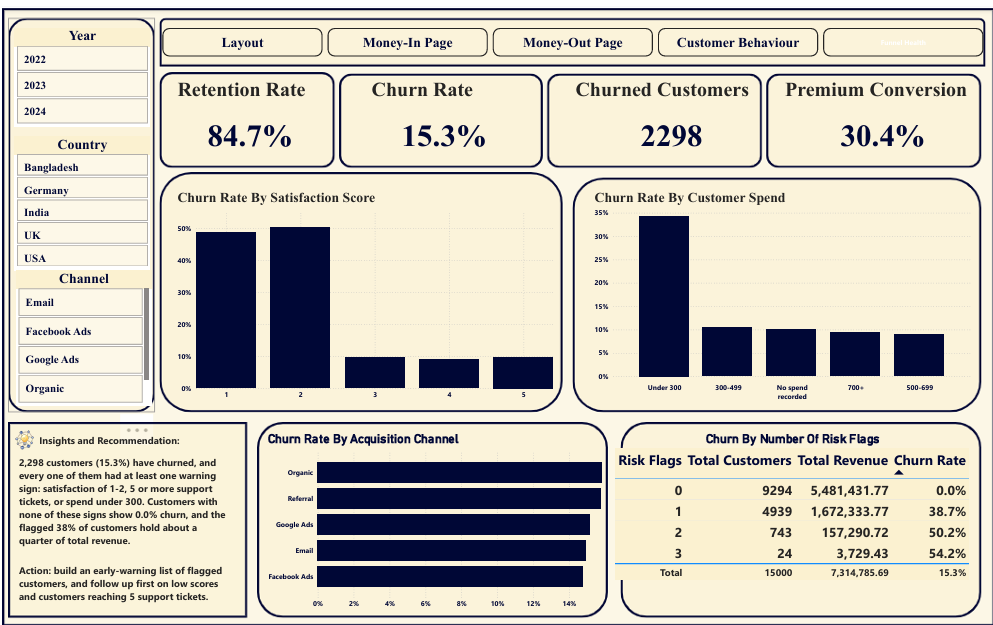

# Customer Revenue & Retention Analysis

**Should next quarter's growth plan focus on acquiring new customers or on reducing churn?**
A four-page Power BI analysis of 15,000 customers, covering revenue, acquisition cost, customer behavior and churn.

---

## Project Background and Overview

A subscription-style online business holds customer-level data on spend, acquisition channel, satisfaction, support activity and churn that has not been turned into decisions. This project analyses 15,000 customers who signed up between January 2022 and September 2024 and answers a single growth question: acquire more customers, or keep the ones already won.

The analysis is organised around four areas, each with its own dashboard page:

- **Money In:** revenue, average order value (AOV) and average revenue per user (ARPU)
- **Money Out:** acquisition cost, return on acquisition spend, refunds and discounts
- **Customer Behavior:** customer base, satisfaction and NPS
- **Funnel Health:** churn, retention and at-risk customers

**Intended audience:** Growth, Finance, Marketing and Customer Success teams.

**Business questions answered**

| Team | Question |
|---|---|
| Finance | Is the business growing, and from more customers or higher spend? |
| Finance | Which segments carry revenue, and are the gaps real? |
| Finance | Is AOV stuck, and where could it be lifted? |
| Marketing | Is acquisition spend efficient, and should any channel be scaled or cut? |
| Finance / Operations | Where is revenue leaking through refunds and discounts? |
| Customer Success | Which signal predicts loyalty: NPS or satisfaction? |
| Customer Success | Who is leaving, what do they have in common, and how much revenue is at risk? |
| Marketing / Product | Do acquisition channel or signup timing affect retention? |

**North Star metrics**

| Metric | Plain-language definition | Value |
|---|---|---|
| Churn rate | Share of customers who have left | 15.3% |
| CAC | Average marketing spend per customer | 17.58 |
| ARPU | Average revenue per customer with recorded spend | 524.36 |

**Links**

- Interactive Power BI dashboard: [`dashboard/customer_revenue_retention.pbix`](dashboard/customer_revenue_retention.pbix)
- Data cleaning notebook (Python / pandas): [`notebooks/data_cleaning.ipynb`](notebooks/data_cleaning.ipynb)
- Full project report: [`docs/project_report.pdf`](docs/project_report.pdf)

> **Note on the data:** the dataset is synthetic. Findings demonstrate the analytical method and judgement, not the performance of a real company.

---

## Data Structure and Initial Checks

**Source:** Sales and Marketing Dataset (Kaggle). One table, 15,000 customers, 30 columns. As the data is a single table, there are no joins, so no entity-relationship diagram applies. Columns are grouped by business area below.

| Group | Columns |
|---|---|
| Customer profile | customer_id, gender, age, country, city, device_type |
| Time | signup_date, last_purchase_date |
| Acquisition | acquisition_channel, marketing_spend_per_user |
| Plan | subscription_type, is_premium_user |
| Engagement | total_visits, avg_session_time, pages_per_session, email_open_rate, email_click_rate |
| Money | total_spent, avg_order_value, discount_used, coupon_code, payment_method, lifetime_value |
| Service and loyalty | support_tickets, refund_requested, delivery_delay_days, satisfaction_score, nps_score, last_3_month_purchase_freq, churn |

**What the data can answer:** revenue per customer, acquisition cost, satisfaction and churn.
**What it cannot answer:** monthly sales (spend is a lifetime total with no order dates), gross margin (no product cost) and visit-to-order conversion (no funnel events).

### Data quality summary

Cleaning followed four rules: never invent a value, flag instead of repair, keep every customer, and test assumptions before relying on them. All 15,000 customers remain in the clean file.

| Issue | Rows affected | Treatment |
|---|---|---|
| Missing values: gender, age, satisfaction, total_spent, coupon_code | 738 / 1,200 / 702 / 1,050 / 6,133 | Labelled "Unknown" or left empty. Never imputed |
| Missing total_spent is not random (churn 10.0% vs 15.7%) | 1,050 | Revenue KPIs calculated on the 13,950 customers with recorded spend |
| Last purchase date before signup date | 3,762 (25.1%) | Flagged with `date_valid`. Not repaired |
| Coupon code contradicts the discount flag | 7,624 (51%) | Left as recorded. Coupon analysis avoided |
| Lifetime value lower than recorded spend | 2,340 | Shown "as provided" with a caveat |
| City does not match country | Observed in the first 20 rows | City not used, no geographic claims |

Step-by-step reasoning for each decision is in the [project report](docs/project_report.pdf).

---

## Executive Summary

Between January 2022 and September 2024, the business acquired 15,000 customers (13,950 with recorded spend) and generated 7.31M in revenue at an ARPU of 524 and an AOV of 60. The business is stable but flat: revenue (about 220k a month), new customers (about 455 a month), AOV and ARPU are almost identical in all three years, and no acquisition channel stands out on cost, return or retention.

The clearest lever is retention. 15.3% of customers (2,298) have churned, and every one of them showed at least one of three warning signs: a satisfaction score of 1-2, five or more support tickets, or total spend under 300. Customers with none of these signs show 0.0% churn, while the flagged 38% of customers hold about a quarter of total revenue.

**Recommendation:** focus next quarter on retention, starting with an early-warning programme for flagged customers.



*Additional dashboard pages:* [Money In](images/money-in.png) | [Money Out](images/money-out.png) | [Customer Behavior](images/customer-behavior.png)

---

## Insights Deep Dive

### Money In

**1. The business is stable, not growing.**

| Year | Revenue | AOV | ARPU |
|---|---|---|---|
| 2022 | 2.67M | 60.28 | 523.29 |
| 2023 | 2.67M | 59.94 | 531.23 |
| 2024 (Jan-Sep) | 1.97M | 60.00 | 516.74 |

2024 appears to be a 26% decline only because the data ends in September. Per month, revenue is about 222k, 222k and 219k. Growth will not appear unless something changes deliberately, so flat acquisition and flat AOV are the baseline to beat.

**2. Senior Adults look like the most valuable segment, but a few large spenders create that picture.** Their ARPU is about 1,079 against about 507 for Adults, yet they hold only about 5% of revenue (355 customers). The median tells a different story:

| Age band | Customers with spend | Mean | Median | Highest |
|---|---|---|---|---|
| Adults (35-54) | 6,350 | 507.0 | 494.9 | 1,404.8 |
| Senior Adults (55+) | 355 | 1,079.0 | 539.8 | 15,910.4 |
| Young Adults (25-34) | 4,276 | 515.5 | 506.6 | 1,475.0 |
| Youth (under 25) | 1,853 | 515.5 | 499.5 | 1,489.3 |
| Unknown | 1,116 | 495.3 | 476.4 | 1,539.3 |

The typical senior spends only about 9% more than the typical adult. One senior spent about ten times more than the top spender in any other group, and capping the top 1% of spenders cuts the senior average to 569, about 12% above Adults. **Action:** identify the large accounts and pilot before investing in the segment.

**3. AOV has not moved in three years** (about 60). Lifting it is a hypothesis to test, such as bundles or a free-delivery threshold just above 60, not a finding.

**4. Payment method, channel and country rankings are noise.** The top payment method changed every year (UPI, PayPal, BKash), as did the top channel (Organic, then Google Ads) and top country (Germany, then Bangladesh), with small gaps. None of them is a reliable basis for action.

### Money Out

**5. No channel earns a bigger budget.** CAC is about 17.58 and ranges only from 17.24 to 17.81 across channels. Each 1 of acquisition spend is matched by about 30 in revenue in every channel. **Action:** hold channel budgets and track CAC over time to see whether it rises with volume.

**6. Refunds and discounts are the real leak.** 15% of customers requested a refund and 49.4% used a discount. Refunds have almost no link with churn (correlation -0.007), so they look like a separate problem from retention. **Action:** break refunds down by plan and channel and test whether discount-led sales are the cause.

### Customer Behavior

**7. NPS is uninformative, while satisfaction is highly predictive.** NPS is -46.2, but scores are spread almost evenly from 0 to 10 (1,303 to 1,417 customers at each score) and show no relationship with satisfaction or churn. Satisfaction (average 3.59 of 5) does:

| Satisfaction | Customers | Churn |
|---|---|---|
| 1 | 753 | 48.7% |
| 2 | 1,455 | 50.2% |
| 3 | 3,739 | 9.7% |
| 4 | 5,323 | 8.9% |
| 5 | 3,028 | 9.7% |

**Action:** use satisfaction to flag at-risk customers, and validate how NPS is collected before relying on it.

**8. Premium status does not change retention.** 30.4% of customers are on premium plans, and premium status has almost no correlation with churn (-0.005).

### Funnel Health

**9. Churn is concentrated, not random.**

| Signal | Churn when present | Churn otherwise |
|---|---|---|
| Satisfaction of 1-2 | about 50% | about 9-10% |
| 5 or more support tickets | 50.4% | 12-14% |
| Spend under 300 | about 34% | about 9-10% |

Churn stays flat from zero to four tickets and jumps only at five, so five tickets is the trigger point.

**10. The warning signs account for every churned customer.**

| Risk flags | Customers | Revenue | Churn |
|---|---|---|---|
| 0 | 9,294 | 5,481,432 | 0.0% |
| 1 | 4,939 | 1,672,334 | 38.7% |
| 2 | 743 | 157,291 | 50.2% |
| 3 | 24 | 3,729 | 54.2% |

All 2,298 churned customers sit in the flagged group of 5,706 customers (38%), which holds 1.83M, about a quarter of total revenue. The customers most likely to leave can be listed before they leave. (A group with exactly 0.0% churn would not occur in a real business, which indicates the data was generated from rules. The method still transfers to real data.)

**11. Acquisition channel does not predict retention.** Churn is between 14.8% and 15.9% in every channel, so reallocating budget between channels will not reduce churn.

---

## Recommendations

| Priority | Action | Evidence | Owner | Metric to track |
|---|---|---|---|---|
| P0 | Launch an early-warning retention programme for flagged customers | Churn is 38.7%, 50.2% and 54.2% at 1, 2 and 3 flags, and 0.0% at none | Customer Success | Churn among flagged customers |
| P1 | Escalate at five support tickets and follow up on satisfaction of 1-2 within days | Churn is 50.4% at 5+ tickets and about 50% at satisfaction 1-2 | Support | Churn at 5+ tickets |
| P1 | Hold channel budgets, with no reallocation on current evidence | Cost, return and churn differ by under 3% across channels | Marketing | Return per 1 spent, CAC by channel |
| P2 | Investigate the large senior accounts and any revenue concentration | Senior mean 1,079 against median 540 | Finance | Revenue share of the largest accounts |
| P2 | Investigate refund drivers and the role of discounts | 15% refund rate, 49.4% discount use | Operations | Refund rate by plan and channel |
| P3 | Track satisfaction, not NPS, until NPS collection is validated | NPS is evenly spread and unrelated to churn | Customer Success | Satisfaction versus churn |

Targets are intentionally left open. They should be set after a pilot, not estimated in advance.

---

## Caveats and Assumptions

- **The data is synthetic.** Several patterns (0.0% churn in the unflagged group, near-identical channels, evenly spread NPS) indicate generated data.
- **Revenue is lifetime, not monthly.** Time charts show revenue by signup cohort, and 2024 contains nine months only.
- **Revenue KPIs cover 13,950 customers.** 1,050 customers have no recorded spend, so true revenue is probably higher.
- **Gross margin is not available** (no product cost), and conversion is limited to premium conversion (30.4%).
- **Lifetime value is shown as provided** and contradicts recorded spend in about 17% of cases.
- **Dates, coupons and geography are inconsistent** and were flagged, not corrected.
- **Small groups need caution.** Senior Adults are 355 customers, and country-by-month patterns rest on very few customers.

---

## Repository Contents

```
├── README.md
├── data/
│   └── sales_marketing_clean.csv
├── notebooks/
│   └── data_cleaning.ipynb
├── dashboard/
│   └── customer_revenue_retention.pbix
├── images/
│   ├── money-in.png
│   ├── money-out.png
│   ├── customer-behavior.png
│   └── funnel-health.png
└── docs/
    └── project_report.pdf
```

**Tools:** Python (pandas) in Jupyter Lab for cleaning and validation, Power BI Desktop for the dashboards.

*Prepared by Emmanuel Adebomi (Emmizee).*
